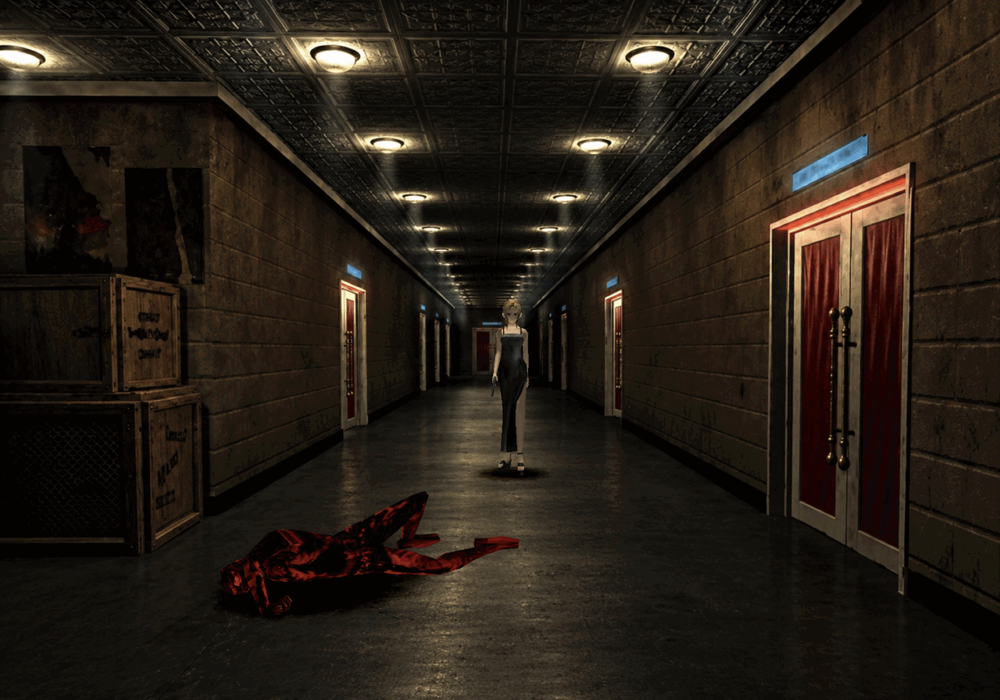

# Parasite Eve

[](https://discord.gg/bQkCVvrkem)

A native PC port of Parasite Eve, built from the original game code with
[our PsyZ fork](https://github.com/khasinski/parasite-eve-psyz).



## Play

Download the game from [GitHub Releases](https://github.com/khasinski/parasite-eve-pc/releases).
This is an early alpha; see the release notes for available platforms and known issues.
See the [changelog](CHANGELOG.md) for changes.

You need your own **North American CUE/BIN images**. Game data is not included.
Keep each CUE file next to its BIN file.

1. Launch Parasite Eve and select your disc images. Selecting both discs enables automatic switching.
2. You can start with either disc. If the other is needed, the game asks for it by name.
3. Press **Escape** for graphics, controls, audio and disc settings. You can add the other disc there later.

**Enter** is START and skips movies; in a story movie, START pauses it and asks whether to skip. View or change all bindings in **Escape → Controls**. A **speed** button can be bound there too: the game runs at 2x while it is held, or 3x or 4x with the arrows either side of the number (Left/Right on that row). It is unbound until you choose a key or button, and keeps your VSync setting.
The left stick provides analog movement. **Escape → Controls → Field run threshold** sets how far to push it before Aya runs (85% by default).
Settings and selected disc paths are saved automatically. Memory cards are kept in `memory-cards` beside your user preferences. Older `bu00`/`bu10` cards from the launch or executable folder are imported once, keeping the original files.
Optional geometry correction, antialiasing and model texture filtering are in **Escape → Graphics**.

## Mods

Downloads include an optional mod host. When building from source, enable it with `-DPE_MODS=ON`: the
`PE_HOOK(...)` lines in the game compile to nothing. In a mod build, **F1** opens the Mods panel;
mods start only after **F1 → Manage mods → All mods** is turned on and the game restarted.
Settings are saved in `pe_mods.ini`. See [the mod guide](mods/README.md) for writing a mod.

### PE Enhancements

Open **F1 → PE Enhancements** to configure them.

- **Movement** (`pe_qol`): Always Run and configurable walk, run, combat and battle-entry speeds
  (walking and running default to 1.75×).
- **Encounters** (`pe_qol`): no random battles, or Normal, 2×, 4× or Every Check frequency. Story
  and room rules still apply; this changes how often fights happen, not their size.

Mod builds are experimental; a passing build or test does not establish full in-game compatibility.

## Build

Requires Git, CMake 3.21 or newer and a C11 compiler.

```sh
git clone https://github.com/khasinski/parasite-eve-pc
cd parasite-eve-pc
git submodule update --init third_party/psyz
git -C third_party/psyz submodule update --init external/SDL
cmake -S . -B build -DBUILD_TESTING=OFF -DCMAKE_BUILD_TYPE=RelWithDebInfo
cmake --build build --parallel
./build/parasite-eve-pc
```

### Build with mods

```sh
cmake -S . -B build-mods -DCMAKE_BUILD_TYPE=RelWithDebInfo -DPE_MODS=ON
cmake --build build-mods --parallel
./build-mods/parasite-eve-pc
```

`PE_MOD_LIST` picks the mods by folder name (default: `pe_qol`).

For development details, see [code organization](docs/CODE_ORGANIZATION.md).
